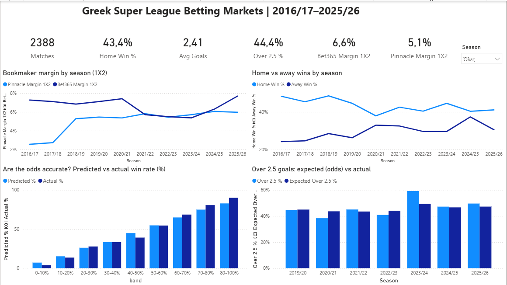
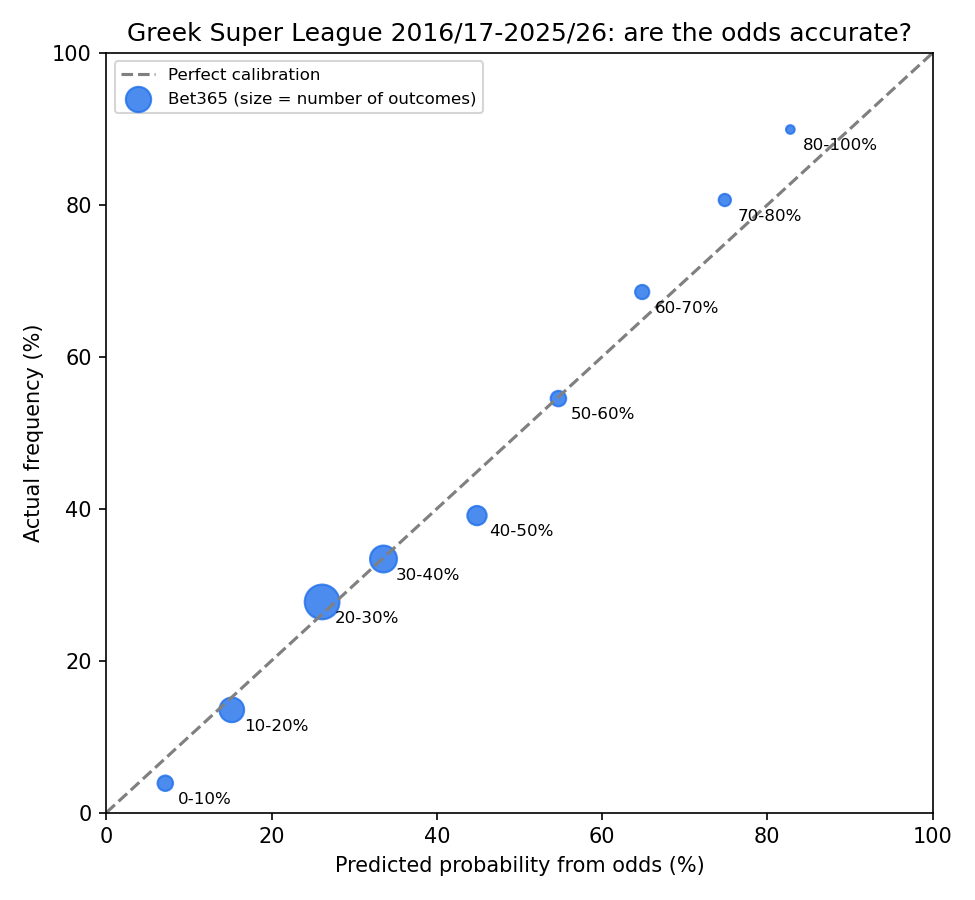

# Greek Super League Betting Markets (2016/17–2025/26)

How accurate are bookmaker odds in the Greek Super League, how much margin do bookmakers build into each market, and where does that margin come from?
Python (pandas, SciPy), SQL (SQLite) and Power BI on 2,388 real matches with Bet365 and Pinnacle odds.



## Questions
1. **Margin:** How large is the bookmaker margin (overround) in the 1X2 and Over/Under 2.5 markets, and how did it change by season?
2. **Accuracy:** When the odds imply a probability of X%, does the outcome happen X% of the time? Is there a favourite-longshot bias?
3. **Home advantage:** How strong is it, is it changing, and was 2020/21 (empty stadiums) different?
4. **Business view:** How much does each market keep (hold) from stakes, in theory and in practice?

## Data
- Source: [football-data.co.uk – Greece](https://www.football-data.co.uk/greecem.php), one `G1.csv` file per season, 10 seasons (2016/17–2025/26). Column dictionary: [notes.txt](https://www.football-data.co.uk/notes.txt).
- 2,388 matches after cleaning (regular season, play-offs and play-outs; 240 per season, 233 in 2024/25 and 236 in 2025/26).
- Odds used: Bet365 and Pinnacle, 1X2 (all seasons) and Over/Under 2.5 goals (from 2019/20, the first season these columns exist).
- The raw files are not included in this repository. Download them from the link above into `data-raw/` as `G1_1617.csv` … `G1_2526.csv` to reproduce the analysis.

## Method
1. **Load & clean** (`01_load_clean.ipynb`, pandas): stacked 10 files with different column sets (52–131 columns), parsed two date formats, removed 1 match without a result, checked that every result agrees with the goals (0 mismatches), duplicates (0) and team names (25 teams, one spelling each). Investigated an outlier season (2023/24: 2.96 goals per match) and confirmed it is real data, not an error.
2. **Feature engineering:** implied probability = 1 / odds; overround = sum of implied probabilities − 1; fair (margin-free) probability = implied probability / sum. Exported to CSV and a SQLite database.
3. **SQL analysis** (`.sql` files, SQLite in DBeaver): season overview, calibration by probability band (CTE + `UNION ALL`), player return by odds band, home advantage by season, theoretical vs actual hold by market.
4. **Statistical tests** (`02_statistical_tests.ipynb`, SciPy): binomial tests per probability band, chi-square test of independence, linear regression on the season trend, Brier score with a paired t-test.
5. **Dashboard** (Power BI): KPI cards, margin and home/away trends by season, calibration chart, Over 2.5 expected vs actual, season slicer.

## Key Findings
**1. Margins converged.** Bet365's average 1X2 margin was 6.6% over the 10 seasons (lowest 5.4% in 2023/24, highest 7.7% in 2025/26). Pinnacle, the low-margin benchmark, charged only 2.5–2.7% in 2016/17–2017/18 but 5.3–6.1% from 2018/19 onwards. In 2021/22–2024/25 the two bookmakers were within 0.3 percentage points of each other; in 2025/26 Bet365 rose to 7.7% vs 6.0% for Pinnacle (Pinnacle based on 54 matches). Over/Under 2.5 margins (2019/20+) were 5.6–6.3% at Bet365 and 5.1–6.3% at Pinnacle.

**2. The odds are well calibrated overall, but show a clear favourite-longshot bias.**
- Outsiders priced at 10.00 or more won **3.4%** of the time vs a fair probability of **6.9%** (410 outcomes, binomial p = 0.003). A 1-unit stake on every such outcome would have returned **−62.7%**.
- Strong favourites priced below 1.50 won **78.3%** vs **73.6%** fair (655 outcomes, p = 0.006). The same flat stake returned only **−0.5%**.
- Of 9 probability bands, 4 differ significantly from the odds (0–10%, 40–50%, 70–80%, 80–100%; p < 0.05).
- **Business meaning:** most of the bookmaker's margin is earned on longshots, not on favourites.



**3. Hold by market (2019/20–2025/26, 1 unit on every outcome).**

| Market | Matches | Avg margin | Theoretical hold | Actual hold |
|---|---|---|---|---|
| Bet365 1X2 | 1,652 | 6.43% | 6.02% | 8.56% |
| Bet365 Over/Under 2.5 | 1,651 | 6.05% | 5.70% | 5.93% |
| Pinnacle 1X2 | 1,449 | 5.65% | 5.34% | 8.57% |
| Pinnacle Over/Under 2.5 | 1,449 | 5.48% | 5.20% | 5.39% |

Over/Under kept almost exactly its theoretical margin; 1X2 kept more, because equal stakes on all three outcomes give a large weight to longshots (see finding 2).

**4. Home advantage is shrinking.** The home-win share fell from 48.3% (2016/17) to 41.1% (2025/26): **−0.78 percentage points per season** (linear regression, p = 0.035, R² = 0.45). In 2020/21, with empty stadiums, home teams won 37.9% vs 44.0% in the other seasons, but the difference in the H/D/A distribution is **not statistically significant** (chi-square p = 0.19). 2024/25, with fans, had an even smaller home-minus-away gap (3.0 pp) than 2020/21 (5.0 pp).

**5. 2023/24 surprised the market.** 59.2% of matches had over 2.5 goals, while Bet365's odds implied 49.4% (the highest expectation of any season). In the other six seasons with Over/Under odds, the gap was at most 5.3 percentage points.

**6. Pinnacle predicts slightly better.** On the 2,022 matches priced by both bookmakers, Pinnacle's Brier score was 0.5548 vs 0.5562 for Bet365 (paired t-test p = 0.022). Both are far better than a naive forecast that always predicts the long-run H/D/A shares (0.6523).

## Limitations
- Odds are the pre-match odds published by football-data.co.uk, not closing odds.
- Over/Under odds exist only from 2019/20. Pinnacle odds are missing for 182 of 236 matches in 2025/26 (and 31–60 per season in 2016/17–2018/19), so those seasons' Pinnacle figures rest on fewer matches.
- "Actual hold" assumes 1 unit staked on every outcome. Real customer stakes are not equally spread, so real hold will differ.
- Seasons include play-offs and play-outs, where teams play only teams of similar strength.
- The home-advantage trend uses 10 data points, and season comparisons show correlation, not causation (e.g. fans vs no fans).
- 9 calibration bands were tested without a multiple-testing correction, so one of the significant results could be due to chance.

## SQL Queries
| File | What it answers |
|---|---|
| `01_season_overview.sql` | Results, goals and bookmaker margins per season |
| `02_calibration.sql` | Predicted vs actual win rate per 10-point probability band (CTE + UNION ALL) |
| `03_return_by_odds_band.sql` | Return of a flat stake per odds band (favourite-longshot bias) |
| `04_home_advantage.sql` | Home vs away wins per season, empty-stadium season flagged |
| `05_market_hold.sql` | Theoretical vs actual hold per market and bookmaker |

## Repository Structure
```
greek-super-league-betting-markets/
├── README.md
├── 01_load_clean.ipynb          # load 10 seasons, clean, feature engineering, export
├── 02_statistical_tests.ipynb   # binomial, chi-square, regression, Brier score tests
├── 01_season_overview.sql
├── 02_calibration.sql
├── 03_return_by_odds_band.sql
├── 04_home_advantage.sql
├── 05_market_hold.sql
├── greek_betting_markets.pbix   # Power BI dashboard
├── dashboard.png
└── calibration.png              # calibration chart (from 02_statistical_tests.ipynb)
```

## Tools
Python (pandas, NumPy, SciPy, Matplotlib) · SQL (SQLite, DBeaver) · Power BI (DAX measures) · Jupyter

*Analysis of public historical data for portfolio purposes. It is not betting advice.*
